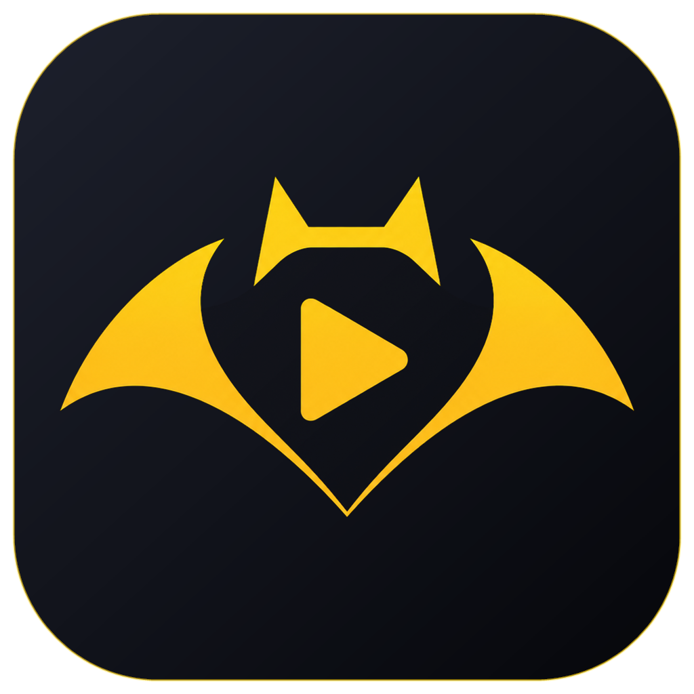

# BatPlayer



BatPlayer is a modern, cross-platform media player built with Tauri v2 and
libmpv. It pairs mpv playback with a dark, minimal interface and an
electric-yellow (`#FFD400`) bat-wing accent.

**Project status:** Milestone 2 of 6 is complete. Playback is wired end to end.
See the [roadmap](#roadmap) for planned work.

## Contents

- [Features](#features)
- [Technology](#technology)
- [Getting started](#getting-started)
- [Development commands](#development-commands)
- [Keyboard shortcuts](#keyboard-shortcuts)
- [Architecture](#architecture)
- [Autotest](#autotest)
- [Project structure](#project-structure)
- [Roadmap](#roadmap)
- [Platform notes](#platform-notes)
- [License](#license)

## Features

- Play media through the libmpv playback engine.
- Open, seek, adjust volume and playback speed, and switch audio and subtitle
  tracks.
- Queue whole folders: Media ▸ Open Folder… or drop a folder onto the window,
  and every media file inside (recursively) joins the queue in a stable
  alphabetical order; mixed file + folder drops work too.
- Use a native video surface with HTML controls layered over it.
- Run on Windows, Linux, and macOS, with platform-specific support and testing
  noted below.

## Technology

- **Application:** Tauri v2
- **Backend:** Rust
- **Playback:** libmpv through the `libmpv2` crate
- **Frontend:** TypeScript, Vite, and Svelte 5
- **Theming:** CSS variables

## Getting started

### Prerequisites

All platforms need [Node.js LTS](https://nodejs.org) and stable
[Rust](https://rustup.rs). Windows builds use the MSVC toolchain.

- **Windows:** Install Visual Studio Build Tools with the “Desktop development
  with C++” workload. Install 7-Zip for the mpv fetch script. WebView2 is
  preinstalled on Windows 10 and 11.
- **Linux:** Install the [Tauri prerequisites for your distribution](https://tauri.app/start/prerequisites/)
  and libmpv. For example: `sudo apt install libmpv-dev` (Debian/Ubuntu),
  `sudo dnf install mpv-devel` (Fedora), or `sudo pacman -S mpv` (Arch).
- **macOS:** Install Xcode Command Line Tools with `xcode-select --install`.
  mpv embedding and window transparency have not yet been tested on macOS.

The libmpv DLL and import library are not committed to the repository. On
Windows, fetch them once with the provided script; this downloads an mpv dev
build and generates `mpv.lib` using Visual Studio tools:

```powershell
powershell -ExecutionPolicy Bypass -File scripts/fetch-mpv.ps1
```

On Linux and macOS, use the system libmpv package. The vendored files are only
used on Windows.

### Install dependencies and start the app

```bash
npm install
npm run tauri dev
```

On Windows, run the mpv fetch script before starting the app if you have not
already done so.

## Development commands

```bash
npm run check        # Svelte and TypeScript checks
npm run build        # Vite production build
npm run tauri build  # Package the application
```

Run Rust commands from `src-tauri/`:

```bash
cargo clippy --all-targets -- -D warnings
cargo fmt
```

Packaging targets (MSI/NSIS on Windows, deb/AppImage on Linux, and dmg on
macOS) are planned for Milestone 5.

## Keyboard shortcuts

VLC-parity keys are marked like here (`q`) and behavioral notes live in
`docs/vlc-behavior-reference.md`.

| Key | Action |
| --- | --- |
| `Ctrl+O` | Open a media file (replaces the playlist) |
| `Ctrl+L` | Toggle the playlist drawer |
| `Space` / `K` (q: `Space`) | Play or pause |
| `F` / double-click video | Toggle fullscreen (`Esc` exits) |
| `←` / `→` | Seek −5 s / +5 s |
| `Shift+←` / `Shift+→` (q) | Seek ±3 s (extrashort) |
| `Alt+←` / `Alt+→` (q) | Seek ±10 s (short) |
| `Ctrl+←` / `Ctrl+→` (q) | Seek ±60 s (medium) |
| `Ctrl+Alt+←` / `Ctrl+Alt+→` (q) | Seek ±300 s (long) |
| `↑` / `↓` / `Ctrl+↑` / `Ctrl+↓` (q) | Increase or decrease volume (5 %) |
| `M` (q) | Mute or unmute |
| `N` / `P` (q) | Next / previous item in the queue |
| `L` (q) | Cycle loop: off → loop all → repeat current |
| `R` (q) | Toggle random play order |
| `E` | Stop (alias; `Esc` while loading cancels the load) |
| `[` / `]` (q) / `+` / `−` (q) / `Backspace` | Slower / faster / ±1.0 speed jump / normal speed |
| `,` / `.` | Previous or next frame while paused |
| `S` or `Shift+S` (q: `Shift+s`) | Save a snapshot to Pictures |
| `A` / `B` (q) / `V` (q) | Cycle audio / audio (VLC) / subtitle track |
| Mouse wheel over video | Volume steps (BatPlayer addition) |

`q:` = the matching default in VLC Media Player 3.0.x, used as the behavioral
reference; plain entries are BatPlayer's own.

## Architecture

BatPlayer renders video in a native child window and layers the Tauri webview
over it. mpv renders into the child window through its `wid` embedding, while
the webview provides the controls and overlays.

```text
┌─ Tauri window ──────────────────────────────┐
│  ┌─ WebView (transparent HTML UI) ───────┐  │
│  │  controls, overlays, idle watermark   │  │
│  ├───────────────────────────────────────┤  │
│  │  ┌─ Native child window (video) ───┐  │  │
│  │  │  mpv renders here via `wid`     │  │  │
│  │  └─────────────────────────────────┘  │  │
│  └───────────────────────────────────────┘  │
└─────────────────────────────────────────────┘
```

- The native child surface is created in `src-tauri/src/platform/`, with a
  module for each OS. It stays at the bottom of the window's z-order and is
  resized to the client area.
- The window is opaque; only the webview is transparent. On Windows,
  window-level transparency uses DWM blur-behind behavior that prevents native
  child windows from compositing correctly. BatPlayer builds the window and
  webview separately with `Window::builder` and `Window::add_child` (Tauri's
  multiwebview API behind the `unstable` feature), applying transparency to
  the webview only.
- mpv runs on its own thread behind a `Player` struct in
  `src-tauri/src/player/`. The UI talks to it through Tauri commands and
  `player-event` property events; it does not access mpv directly.

## Autotest

On Windows, `scripts/autotest.ps1` builds the debug app, plays a generated
2.5-second Y4M test clip (no ffmpeg required), and checks screenshots. It
verifies the captured mpv frame's size, variance, and chroma, then checks that
the app window shows the bat logo, menu bar, play button, and composited video.

Run it with:

```powershell
powershell -ExecutionPolicy Bypass -File scripts/autotest.ps1
```

The following environment variables can also be used for manual debugging:

| Variable | Purpose |
| --- | --- |
| `BATPLAYER_AUTOTEST_FILE` | Automatically play this media file at startup |
| `BATPLAYER_AUTOTEST_SHOT` | Save an mpv screenshot to this path |
| `BATPLAYER_MPV_LOG` | Write a verbose mpv log to this path |

These hooks are inactive unless configured and are compiled out of release
builds.

## Window probe

`scripts/window-probe.ps1` attaches to a *running* instance and proves the
window-manager behavior of the frameless window through Win32, without touching
the UI: the kept resizable/maximizable/minimizable styles, the drag-resize
ring's edge and corner hit-tests (direct and OS-routed), **real scripted
edge drags** that must engage the OS modal sizing loop and move the window
exactly as far as the cursor, minimize/restore round-trips, maximize landing
on the monitor work area, and the webview plus native surface following an
external Snap-like resize.

```powershell
powershell -ExecutionPolicy Bypass -File scripts/window-probe.ps1
```

## Project structure

```text
src-tauri/
├─ build.rs          # Links libmpv and copies the DLL
├─ src/
│  ├─ main.rs        # Application entry point
│  ├─ lib.rs         # Tauri setup: surface, player, and commands
│  ├─ platform/      # Native video surface per OS
│  ├─ commands.rs    # Tauri commands for playback and media controls
│  ├─ player/        # mpv wrapper, observed properties, and event thread
│  ├─ autotest.rs    # Debug-build environment-variable test hooks
│  ├─ settings.rs    # Persisted configuration (planned for Milestone 4)
│  └─ history.rs     # Resume positions and recent files (planned for Milestone 3)
├─ mpv/              # Vendored libmpv files (gitignored; populated by fetch script)
src/
├─ api/              # Typed invoke/listen bindings to Rust commands
├─ components/       # Svelte UI components
├─ stores/           # Playback state, auto-hide, and window flags
├─ i18n/              # Locale files
├─ styles/           # CSS variables and global styles
└─ utils/            # Actions, dialogs, media openers, and formatting
scripts/
├─ fetch-mpv.ps1      # Fetches libmpv on Windows
├─ autotest.ps1       # Windows debug-build visual check
└─ window-probe.ps1   # Window-manager responsiveness proof (drag-resize ring,
                      # real edge drags, minimize/maximize/Snap-follow checks)
```

## Roadmap

1. **Skeleton** — Tauri v2 project, transparent webview, and empty native video
   child window. **Complete.**
2. **Playback** — mpv embedding, open/play/seek/volume/fullscreen, and property
   events to the UI. **Complete.**
3. **Full MVP UI and history** — Recent files in the File menu, resume playback
   when reopening a file, and track menu polish.
4. **Playlist and settings** — Queue with next/previous, auto-advance, loop and
   shuffle; persistent settings for theme, language, and defaults.
5. **Packaging and CI** — Linux, Windows, and macOS.
6. **Polish** — Video adjustments, A-B loop, media info, internationalization,
   themes, and Windows SMTC media keys.

## Platform notes

- **Windows:** The video surface is a `WS_CHILD` window below the WebView2 host.
  Webview transparency composites the native surface, and resize tracking has
  been verified. Avoid window-level transparency (see [Architecture](#architecture)).
  The surface uses the parent's client rectangle in physical pixels; additional
  multi-monitor DPI edge cases are planned for Milestone 3.
- **Linux:** mpv `wid` embedding requires X11 or XWayland. Under Wayland, run
  through XWayland (for example, with `GDK_BACKEND=x11`).
- **macOS:** NSView changes must happen on the main thread. Embedding and
  transparency are currently untested; the native surface is still a stub.

## License

BatPlayer is MIT-licensed; see [LICENSE](LICENSE). From Milestone 2 onward, it
dynamically links libmpv, which is LGPL or GPL depending on the build.
Installer license notices are planned as part of packaging.
